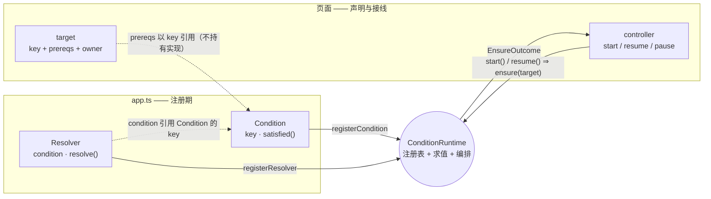
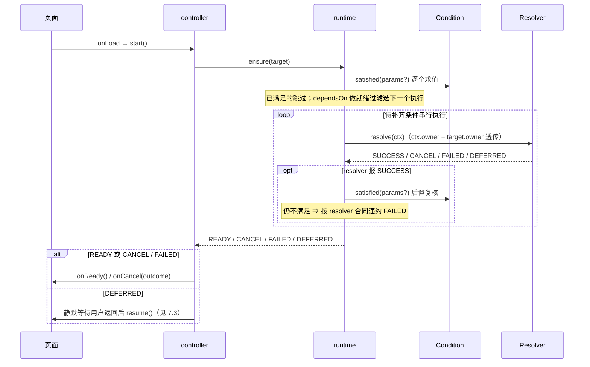
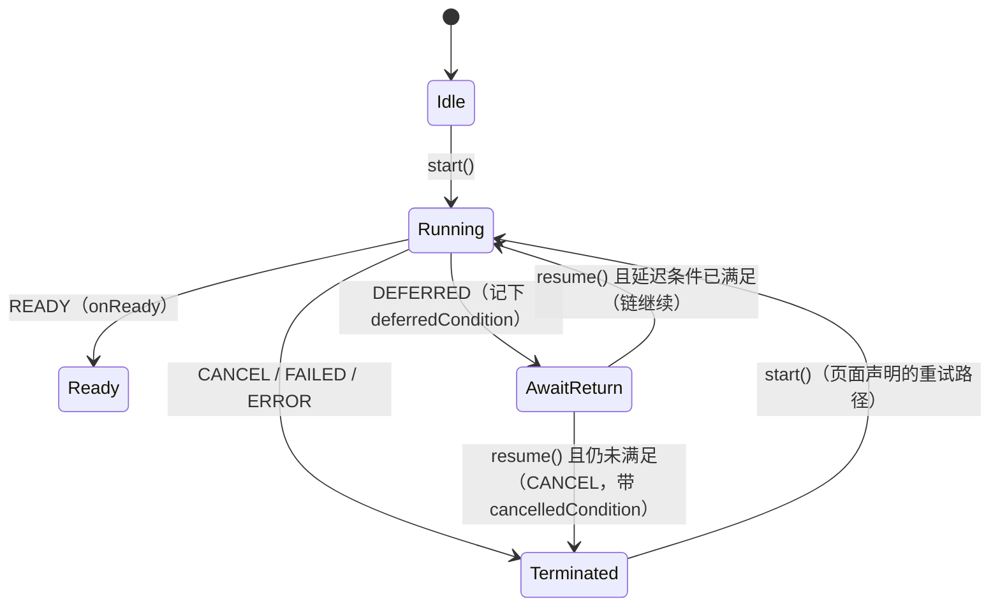

# @mini-dev/condition


> `@mini-dev` 小程序开发工具箱的一员 —— 面向微信**原生**小程序的**前置条件编排引擎**。

页面进入前通常有一组条件需要满足：授权、登录、城市选择、用户协议、实名认证……传统做法把这些检查散落在 `onLoad`、`onShow` 或业务函数里，条件一多就演变成嵌套调用、重复判断和不可控的跳转时序。

condition 让开发者**声明「目标需要哪些条件」**，由运行时负责判断、串行补齐并回调最终结果——不接管页面生命周期，也不包装平台导航。概念如何配对协作，见 [§3 核心模型](#3-核心模型)。

## 目录

1. [在 @mini-dev 工具箱中的位置](#1-在-mini-dev-工具箱中的位置)
2. [它解决什么问题](#2-它解决什么问题)
3. [核心模型](#3-核心模型)
   - [3.1 它们如何协作](#31-它们如何协作)
   - [3.2 一次 start() 里发生了什么](#32-一次-start-里发生了什么)
4. [快速上手](#4-快速上手)
   - [4.1 安装](#41-安装)
   - [4.2 注册一个条件与 resolver](#42-注册一个条件与-resolver)
   - [4.3 页面声明前置条件并接线生命周期](#43-页面声明前置条件并接线生命周期)
   - [4.4 跑通结果](#44-跑通结果)
5. [核心价值主张](#5-核心价值主张)
6. [非目标](#6-非目标)
7. [进阶地图](#7-进阶地图)
   - [7.1 结果语义与按条件失败分支](#71-结果语义与按条件失败分支)
   - [7.2 页内 UI resolver：owner 通道](#72-页内-ui-resolverowner-通道)
   - [7.3 跨页 resolver：DEFERRED 复行](#73-跨页-resolverdeferred-复行)
   - [7.4 依赖排序与参数化条件](#74-依赖排序与参数化条件)
   - [7.5 页面级作用域：parent-child runtime](#75-页面级作用域parent-child-runtime)
   - [7.6 单飞去重与 key 语义](#76-单飞去重与-key-语义)
8. [API 速览](#8-api-速览)
9. [架构原则](#9-架构原则)
10. [单包结构（平台无关）](#10-单包结构平台无关)
11. [开发](#11-开发)
12. [包](#12-包)
13. [文档](#13-文档)
14. [状态](#14-状态)

## 1. 在 @mini-dev 工具箱中的位置

`@mini-dev` 是一组面向微信原生小程序的工具库，每个成员只解决一件事——完整工具箱目录见 [xesam/minidev](https://github.com/xesam/minidev)。

condition 填的是「**进入页面前哪些条件必须先满足**」这一空位：前置条件编排，决定「**去之前先满足什么**」。与决定「去哪」的路由库（如 `@mini-dev/router`）是**正交**的两个维度——condition 不是替代路由框架，而是与路由框架协作。

## 2. 它解决什么问题

以示例项目的电商旅程为例（完整落地见 [examples/wechat-sample](https://github.com/xesam/minidev-condition/tree/main/examples/wechat-sample)）：用户首次进入首页，要先「同意用户协议」「选择城市」才开始加载首页数据；进入收银台则还要「登录」「实名认证」。

用户看到的是这样一条旅程：

```text
进入首页 → 弹《用户协议》点【同意】 → 没选过城市？跳「选城市」页 → 选完返回首页 → 数据开始加载
   │ 拒协议？被挡在门外                │ 选到一半退出？首页停在未就绪，等回来再续
```

传统做法把这些检查散落在 `onLoad`、`onShow` 与业务函数里，`onShow` 里再补「跨页回来后接着查哪一步」。条件扩展到 6–7 个时变成三个问题：

1. 条件逻辑散落在页面和业务代码中，难以复用
2. 条件之间的依赖关系不透明，修改时容易破坏顺序
3. 同一入口在多个触发点重复检查，容易产生重复补齐和竞态行为

condition 把这条旅程收口为一份声明：页面只声明「进入我需要协议、城市」（§3），不满足的条件由它配套的 resolver 负责「怎么补」，串行衔接、哪一步断在哪都带回身份——满足即 `READY`，用户放弃则 `CANCEL` 且告诉你卡在哪个条件上。条件间的 `dependsOn` 用一个轻量「就绪过滤」决定先后——不做完整拓扑排序；若声明互相成环，`ensure()` 返回 `ERROR` 而不是按任意顺序执行。

## 3. 核心模型

- **Condition**：这个条件当前是否满足
- **Resolver**：当条件不满足时，如何补齐它
- **Target**：某个页面或功能入口需要哪些条件
- **Runtime**：对 `Target` 做条件求值、依赖排序、串行补齐，并给出最终结果

**术语约定**（全文固定用法）：

| 术语 | 指代 |
|------|------|
| controller | `createPrerequisiteController` 实例，页面边缘的补齐控制器 |
| runtime | `ConditionRuntime` 实例，条件注册的作用域：global / page-scoped |
| chain | 一次 `ensure()` 的执行链 |
| side-flow | resolver 触发的跨页旁路子过程 |
| 复行 | DEFERRED 后回到原页，`resume()` 复检延迟条件：满足则续链、不满足则终止 |

### 3.1 它们如何协作

用 §2 的旅程给概念对号入座：`agreement`、`city` 各是一个 **Condition**（答「协议同意了吗 / 城市选了吗」）配一个 **Resolver**（弹协议 / 跳选城市页）；首页是一个 **Target**（声明需要 `agreement`、`city`）；**runtime** 是 App 里注册这些条件的地方；首页页面在 **controller** 上接生命周期。

概念间的连接只有三条线：

- **配对**：`Resolver.condition` 指向 `Condition.key`——检查与补齐靠同一个 key 绑定，注册进同一个 runtime
- **引用**：`target.prereqs` 只写 key、不持有实现——页面不知道补齐怎么实现，注册方不知道谁在用，「未注册 ⇒ ERROR」即由此而来
- **翻译**：controller 把页面生命周期翻译成 `runtime.ensure(target)` 调用，拿回 `EnsureOutcome`



图例：实线是调用/数据流；虚线是通过 key 的间接引用。

### 3.2 一次 start() 里发生了什么

runtime 视角的完整求值时序（结果语义详见 7.1，controller 状态机详见 7.3）：



`ERROR`（未注册条件/resolver、`dependsOn` 成环）不进此图——`ensure()` 直接返回 `ERROR`，controller 仅 console 报错并终止。

## 4. 快速上手

以下四小节是一个**最小可运行闭环**：逐段复制即可得到一个能观察到 `READY` 的条件补齐流程（以「登录」为例，页内弹窗补齐，无需跳页）。

### 4.1 安装

```bash
npm install @mini-dev/condition
# 或
pnpm add @mini-dev/condition
```

### 4.2 注册一个条件与 resolver

在 `app.ts` 里创建全局 runtime 并注册（以「登录」为例）：

```ts
import { ConditionRuntime, ResolveResult } from '@mini-dev/condition'
import type { Condition, Resolver } from '@mini-dev/condition'

// 条件：本地是否已有登录态
const loginCondition: Condition = {
  key: 'login',
  satisfied: () => !!wx.getStorageSync('user_token'),
}

// resolver：页内弹窗补齐（不发跳转，一次 ensure 内完成）
const loginResolver: Resolver = {
  condition: 'login',
  async resolve() {
    const { confirm } = await wx.showModal({
      title: '登录',
      content: '登录后才能查看本页，是否登录？',
    })
    if (!confirm) return ResolveResult.CANCEL
    wx.setStorageSync('user_token', 'demo-token')
    return ResolveResult.SUCCESS
  },
}

// App 自己持有 runtime 实例，页面通过 getApp() 取用 —— 库不持有单例
const runtime = new ConditionRuntime()
runtime.registerCondition(loginCondition)
runtime.registerResolver(loginResolver)

App({ globalData: { runtime } })
```

### 4.3 页面声明前置条件并接线生命周期

```ts
import { createPrerequisiteController } from '@mini-dev/condition'

const controller = createPrerequisiteController({
  runtime: getApp().globalData.runtime, // 全局 runtime
  key: 'pages/index/index',             // 页面唯一标识（亦即调用方身份，见 7.6）
  prereqs: ['login'],                   // 声明前置条件（裸字符串会转为 { condition } 格式）
  onReady: () => {
    // 全部条件满足，加载页面数据
  },
  onCancel: () => {
    // 用户取消了补齐（本例：弹窗点了「取消」）
  },
})

Page({
  onLoad()   { controller.start()  },  // 页面新实例，首次求值
  onShow()   { controller.resume() },  // 跨页返回后复行
  onHide()   { controller.pause()  },  // 标记已离开，供下次 resume 判定
  onUnload() { controller.dispose() },  // 清理资源（可选）
})
```

### 4.4 跑通结果

打开本页：本地无 `user_token` → 弹窗询问 → 点「确定」写入 storage → runtime 复核 `loginCondition.satisfied()` 通过 → `onReady` 触发。刷新或再次进入页面时条件已满足，弹窗不再出现。

到此就是一个完整的「声明 → 补齐 → 就绪」闭环。要按条件分支失败策略、驱动页内自定义 UI、处理跨页补齐，继续往下。

## 5. 核心价值主张

| 特性 | 说明 |
|------|------|
| **声明式** | 用 `Target` 声明目标所需条件，不写过程式 `checkXXX()` 链 |
| **可组合** | 条件和补齐逻辑以 `Condition` / `Resolver` 为单位独立注册、独立测试 |
| **可扩展** | 新增条件主要通过新增注册项完成，不需要修改页面主流程 |
| **可推导** | 运行时按依赖关系决定执行顺序（就绪过滤，非完整拓扑排序） |
| **跨平台** | 核心只描述条件编排，平台差异由调用方（resolver / 页面代码）承接，不在库内 |

**目标用户**：有多个页面前置条件的小程序业务开发者；需要统一准入流程规范的基础设施团队。

## 6. 非目标

condition **负责**：

- 条件声明
- 条件依赖排序
- 条件补齐流程编排
- 成功 / 取消 / 失败结果返回

condition **不负责**：

- 路由框架
- 页面生命周期建模
- 状态管理
- UI 组件库
- 各平台导航 API 的统一抽象

平台导航、生命周期接线、跨页结果回传都属于外围集成问题，不是 condition 核心领域的一部分。

## 7. 进阶地图

以下各节互相独立，按需取用。

### 7.1 结果语义与按条件失败分支

场景：首页同时要求协议与城市，用户拒绝协议应当退出小程序，没选城市则可以请他重试——两种「不满足」要区别对待，而挂掉的具体是哪个条件就是分支依据。

`ensure()` 的每次编排返回一个判别联合 `EnsureOutcome`：

| result | 触发 | 附带字段 | 语义 |
|--------|------|----------|------|
| `READY` | 全部条件满足 | — | 链完成，`onReady` 触发 |
| `CANCEL` | resolver 返回 `CANCEL`，或 DEFERRED 后返回仍未满足 | `cancelledCondition` | 用户主动放弃 |
| `FAILED` | resolver 返回 `FAILED` / 抛异常 / 谎报 SUCCESS 复核不通过 | `failedCondition?`（抛异常时缺省） | 补齐失败 |
| `DEFERRED` | resolver 触发跨页跳转后立即返回 | `deferredCondition` | 等用户回来复行（见 7.3） |
| `ERROR` | 条件 / resolver 未注册，或 `dependsOn` 成环 | `message` | **编程错误**，与运行时失败分离；仅 console 报错，不触发 `onCancel` |

失败身份让**单个 controller 即可表达各条件不同的失败策略**——例如「拒协议要退出、未选城要重试」，无需拆成多个链式 controller：

```ts
onCancel: (outcome) => {
  const blocked = outcome.result === EnsureResult.CANCEL
    ? outcome.cancelledCondition.condition
    : outcome.failedCondition?.condition
  if (blocked === 'agreement') wx.exitMiniProgram({})  // 拒协议 → 退出
  else controller.start()                              // 未选城 → 重试
},
```

纪律：`onCancel` 里调用 `start()` 是页面声明重试策略的位置，已满足的条件会被跳过；循环防护是调用方责任——立即再 DEFERRED 的 resolver 会形成循环。

### 7.2 页内 UI resolver：owner 通道

resolver 需要驱动发起页自己的 UI（如页内协议 overlay，`wx.showModal` 装不下长文本）时，不要走全局可变状态（globalData 钩子——反模式）。页面在 controller 上声明 `owner: this`，overlay 作为页面普通方法；resolver 声明所需形状并在 `ctx.owner` 上取用，形状缺失时显式返回 `FAILED`：

```ts
interface AgreementOwner { presentAgreement(): Promise<boolean> }

class AgreementResolver implements Resolver<AgreementOwner> {
  condition = 'agreement'
  async resolve(ctx: ResolveContext<AgreementOwner>) {
    const page = ctx.owner
    if (!page?.presentAgreement) return ResolveResult.FAILED
    return (await page.presentAgreement()) ? ResolveResult.SUCCESS : ResolveResult.CANCEL
  }
}
```

owner 随**每次 ensure 调用**携带（不进去重 key，见 7.6）：哪个页面在跑，`start()` 的瞬间即确定——per-controller 携带、天然隔离，无需注册与清理。A 页 `owner: this` 直接透传，B 页形状不同就传适配对象。

纪律：in-call resolver await 的 promise 由 owner 创建，页面卸载时必须兑现（`onUnload` 里 resolve/reject），否则 `ensure()` 连同 in-flight 去重项永久悬挂；resolver 必须观察该产生物的拒绝。

### 7.3 跨页 resolver：DEFERRED 复行

resolver 需要另一个页面补齐时（选城市、实名页），自己用 App 的路由触发导航并**立即**返回 `ResolveResult.DEFERRED`：

```ts
const cityResolver: Resolver = {
  condition: 'city',
  async resolve() {
    wx.navigateTo({ url: '/pages/city/city' })
    return ResolveResult.DEFERRED
  },
}
```

`ensure()` 随之返回 `DEFERRED`，原页保持未就绪。用户返回原页时 `resume()` 复行：延迟条件已满足则链继续，仍未满足则终止（`CANCEL`，不重复触发跳转，避免循环——即**一次复行机会**，全新页面实例才重置）。全新页面实例（`start`）总是重新尝试。`Condition.satisfied()` 是唯一的完成信号——跨页结果怎么写回 storage、怎么回传，都是 App 层自己的事。

复行契约的关键点：

1. **目标页不是 condition-runtime-aware**：跳过去的页面只写 storage + 返回，库不持有 channel、不注入通信 query、不 bypass app 路由
2. **`ensure()` 是唯一编排入口**：core 不理解 `onLoad` / `onShow` / `APP_SHOW` 等平台事件，生命周期接线由 controller 翻译
3. **补齐后置校验**：每个 resolver 报告 `SUCCESS` 后 runtime 重新校验 `isSatisfied()`，仍不满足则按 `FAILED` 处理（resolver 合同违约不静默通过）

controller 的复行判定状态机（`pause` 只标记「真离开过」，stray `resume` 是 no-op）：



### 7.4 依赖排序与参数化条件

场景：提现页要求「登录」，但登录之前必须先同意隐私协议；同一个能力检查在支付页要带 `payment_v2` 参数、在提现页要带 `cash_out` 参数，各自独立算一次。

条件声明的 `dependsOn` 参与**就绪过滤**（非完整拓扑排序）：某条件的依赖也处于待补齐集合时，它靠后执行；互相成环则 `ensure()` 返回 `ERROR`。`dependsOn` 只在**同一个 target 内**生效，target 之外的条件视为已满足，不阻塞。

```ts
// auth 声明依赖 agreement：dependsOn 用于就绪过滤（非拓扑排序）
const authCondition = {
  key: 'auth',
  dependsOn: ['agreement'],
  satisfied: () => !!wx.getStorageSync('user_token'),
}
```

同一个 condition key 可带不同 `params`，各自独立求值、独立补齐（不互相吞并）：

```ts
const target = {
  key: 'pay',
  conditions: [
    { condition: 'auth' },  // 全局授权
    { condition: 'feature_check', params: { feature: 'payment_v2' } },  // 支付 v2 功能检查
    { condition: 'feature_check', params: { feature: 'risk_control' } }, // 风控检查
  ],
}
```

params 的语义由条件定义决定。示例项目的 city 条件把带参求值定义为**期望状态（desired）**：`satisfied({ externalCity })` 做**精确匹配**（本地 = 期望才满足）、无参做存在性检查——本地缺失 → resolver 免跳页**补齐**；本地是其他城市 → 同样不满足 → resolver 免跳页**替换**。完整演示见 [examples/wechat-sample](https://github.com/xesam/minidev-condition/tree/main/examples/wechat-sample) 的 DevTools 编译模式「外部启动带city参数」与 [ACCEPTANCE.md](https://github.com/xesam/minidev-condition/blob/main/examples/wechat-sample/ACCEPTANCE.md) 组 D。

### 7.5 页面级作用域：parent-child runtime

场景：抽奖活动页既要全网共享的条件（登录、实名），又要一个只属于本页的条件（如抽奖频控/黑名单校验）——后者注册到全局 runtime 会平白暴露给所有页面，还可能与别处的同名 key 冲突。

页面专属条件可挂在 page-scoped runtime 上（`new ConditionRuntime(globalRuntime)`），页面在 `onUnload` 显式调用 `dispose()` 即清理本 runtime 的全部注册（不影响 global runtime；不调用则残留，`dispose` 没有隐式触发点）。

**没有 `scope` 标签**——ref 归谁解，由「谁注册了这个 condition key」决定，条件注册在哪个 runtime 就属于哪个作用域。

**路由**：`ensure(target)` 把 `target.conditions` 分成三组：

- **selfOwned**：注册在本 runtime 上的 ref（若父子都注册，**child 覆盖 parent**）→ 本地解
- **parentOwned**：本 runtime 没注册、parent 注册了的 ref → 委托 `parent.ensure(...)`
- **neither**：两边都没注册 → 返回 `ERROR`（与「未注册 resolver」同一 ERROR 通道）

**parent-first 硬屏障**——parentOwned 全部达到 READY 才进入 selfOwned：

- **跨层顺序免费**：parent 持有的条件整体先于 child 持有的条件，不用逐对写 `dependsOn`
- **短路保护**：parent 阶段挂掉（失败/取消/跳页 deferred），child resolver 绝不触发——避免「全局 side-flow 还没结束就叠加页内 side-flow」
- **跨层依赖**：child 条件 `dependsOn` parent 条件时无需声明——parent 阶段先全 READY，进入 child 阶段时依赖天然满足
- `isSatisfied` 查询是 `self ?? parent`：child 阶段的 resolver 能查到 parent 已解的条件；parent 阶段返回的 `deferredCondition` 随 outcome 原样透传

pay 页示意时序（`auth`/`realname` 在 global runtime，`feature_check` 在 page runtime）：

```text
pageRuntime.ensure([auth, realname, feature_check])
  │ 路由：parentOwned=[auth, realname]  selfOwned=[feature_check]
  ▼
globalRuntime.ensure([auth, realname])          ── parent 阶段
  │ auth 未满足 → AuthResolver: wx.navigateTo(/pages/auth) → DEFERRED
  ▼ ensure 返回 DEFERRED，pageRuntime 透传，原页 pause
  ··· 用户在 auth 页点「Grant」→ 写 __demo_auth → navigateBack ···
  ▼ 原页 onShow → pageRuntime.resume() → 复检 auth ✓ → 重跑 ensure
globalRuntime.ensure([auth, realname]) → READY   ── parent 阶段完成
  ▼
pageRuntime 内部执行 selfOwned=[feature_check] ── 本阶段示意，非公开 API
  │ feature_check 未满足 → FeatureCheckResolver: wx.showModal(payment_v2) → SUCCESS
  ▼ 后置校验 ✓ → READY → onReady()
```

注意 `feature_check`（page）排在 `auth`/`realname`（global）之后是 parent-first 决定的，不是数组顺序。（本时序图仅示意机制；`examples/wechat-sample` 的实际演示不使用 parent-child，parent-child 的单测见 `__tests__/parent-child.test.ts`。）

### 7.6 单飞去重与 key 语义

场景：用户连点按钮触发两次 `start()`，或多个入口对同一目标并发 `ensure()`——同一条链不应重复弹窗、重复跳转，resolver 也只应执行一次。

同一 runtime 上，`key` + `conditions`（含 params）标识的 target 若已有 in-flight 的 `ensure()`，后来的调用**复用同一个 promise**（resolver 只执行一次）：

- **key 即调用方身份**——`owner` 是该身份的附随物，不进去重 key；同 key 同条件并发时第一个调用的 owner 生效
- 去重 key 会序列化 params；owner 是不透明引用，永远不参与序列化

## 8. API 速览

| 接口 | 字段 / 方法 | 说明 |
|------|-------------|------|
| `Condition` | `key` / `satisfied(params?)` / `dependsOn?` | 只回答「是否满足」，无副作用；`dependsOn` 仅同 target 内生效 |
| `Resolver<TOwner>` | `condition` / `resolve(ctx)` | 页内补齐返回 `SUCCESS / CANCEL / FAILED`，跨页返回 `DEFERRED` |
| `ResolveResult` | `SUCCESS / CANCEL / FAILED / DEFERRED` | resolver 级结果；`DEFERRED` 后 runtime 立即返回 |
| `EnsureResult` | `READY / CANCEL / FAILED / DEFERRED / ERROR` | `ensure()` 的链级结果枚举，判别联合 `EnsureOutcome`（见 7.1） |
| `Target` | `key` / `conditions` / `owner?` | 一次 ensure 的求值对象；`owner` 为发起者引用（通常页面实例） |
| `ConditionRuntime` | `ensure(target)` / `registerCondition` / `registerResolver` / `isSatisfied` / `dispose` | 求值、排序、单飞去重；`dispose` 清空本 runtime 全部注册 |
| `EnsureOutcome` | 判别联合 | 见 7.1 结果语义表 |
| `ResolveContext<TOwner>` | `target` / `params` / `runtime` / `owner?` | 传给 resolver 的调用现场 |
| `RuntimeView` | `isSatisfied(key, params?)` | resolver 查询其他条件的最小窗口（无导航糖） |
| controller | `start / resume / pause / dispose` | 生命周期接线四方法，状态机见 7.3 |

## 9. 架构原则

1. **领域优先**：core 只保留条件编排必需的概念，无平台名词。
2. **注册地即作用域**：parent-child 靠注册地路由，无 `scope` 标签，避免标签与注册地对不上的脚枪。
3. **显式控制流**：用命令式 `ensure()` 替代平台事件驱动 core；生命周期在外围被翻译。
4. **平台细节在外围**：导航、跨页回传、生命周期接线由 resolver/页面代码承担，库不内置 adapter 层。
5. **外围可替换**：同一 core 可对接不同平台（sample 用 `wx.*`，其它平台换自己的路由即可）。

## 10. 单包结构（平台无关）

| 模块 | 职责 |
|------|------|
| 领域核心 | `Condition` / `Resolver` / `Target` / `ConditionRuntime`，不含任何平台概念 |
| 页面边缘糖 | `createPrerequisiteController` 把页面生命周期翻译成显式 `ensure()` 调用，仍平台无关 |

两者同处 `@mini-dev/condition` 一个包——都是纯 TS、无平台依赖，没有"领域层 vs 适配层"的边界要守。库**不**包含微信适配层——导航、跨页结果回传、生命周期接线都由 resolver / 页面代码用 App 自己的路由承接。[examples/wechat-sample](https://github.com/xesam/minidev-condition/tree/main/examples/wechat-sample) 用 `wx.*` 直接落地。

包依赖关系：

```text
@mini-dev/condition          (no internal deps)
  ↑
examples/wechat-sample     → @mini-dev/condition   (uses wx.* directly in resolvers/pages)
```

## 11. 开发

```bash
# 构建所有包（tsdown: ESM + CJS，各自生成对应格式的 .d.ts）
pnpm build

# 运行所有测试（vitest）
pnpm test

# 按包运行
pnpm --filter @mini-dev/condition test

# 类型检查（仅 lint，无独立 linter）
pnpm lint
pnpm --filter @mini-dev/condition lint   # tsc --noEmit

# 按包 watch 模式
pnpm --filter @mini-dev/condition dev     # tsdown --watch

# wechat-sample e2e（需要微信开发者工具 + miniprogram-automator）
pnpm --filter @mini-dev/condition-wechat-sample e2e
```

## 12. 包

| 包名 | 说明 |
|------|------|
| `@mini-dev/condition` | 前置条件编排引擎 + 页面生命周期接线（`createPrerequisiteController` 等） |

## 13. 文档

- [CHANGELOG.md](./CHANGELOG.md) — 版本历史（随包分发）
- [examples/wechat-sample](https://github.com/xesam/minidev-condition/tree/main/examples/wechat-sample) — 完整落地示例（含编译模式「外部启动带city参数」演示与 e2e）

## 14. 状态

- 已发布：[0.1.2](https://www.npmjs.com/package/@mini-dev/condition)（见 [CHANGELOG.md](./CHANGELOG.md)）
